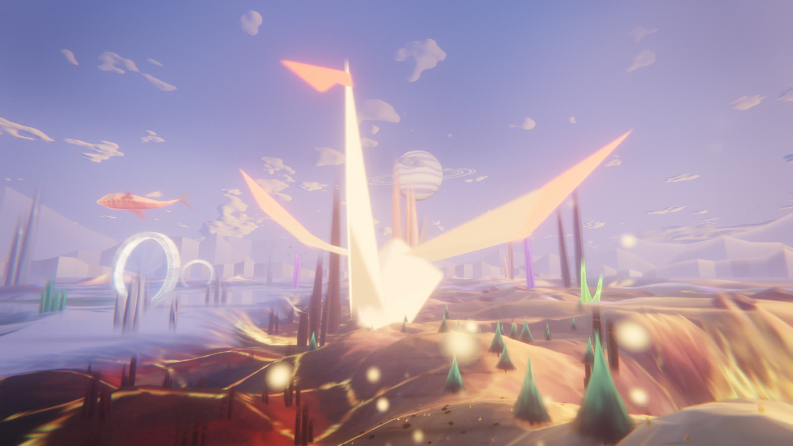
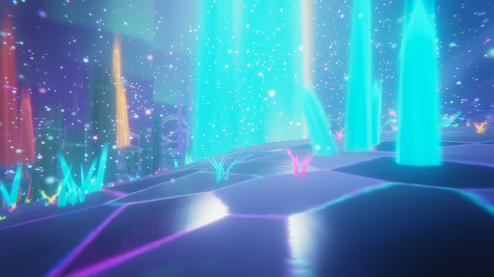
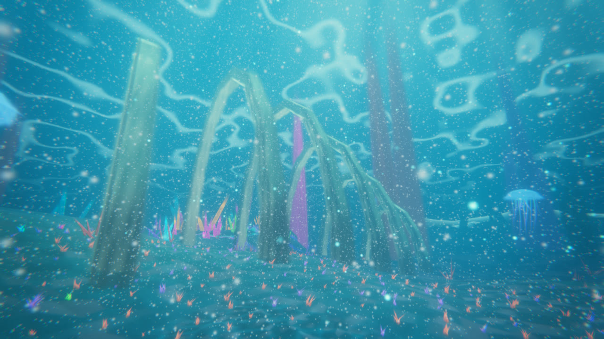
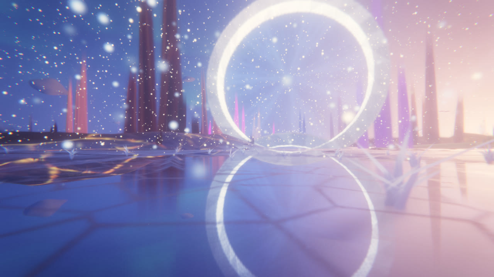
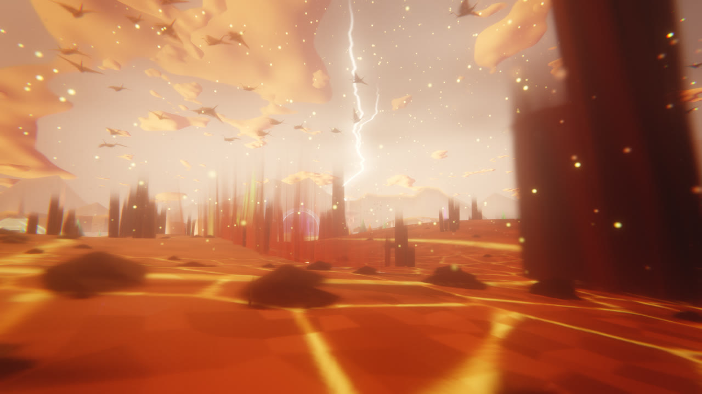
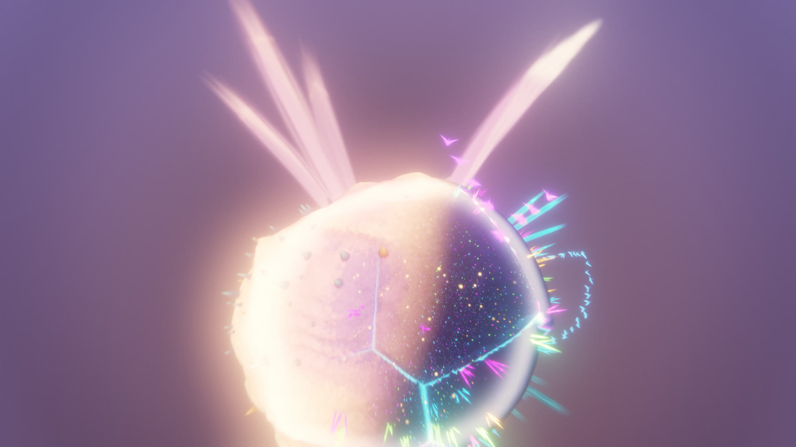
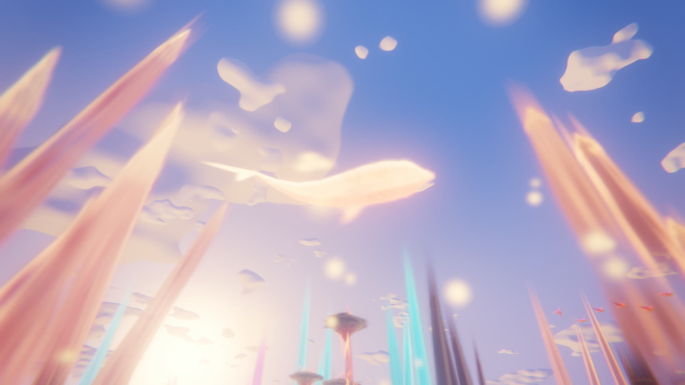

# Reality Origami

An endless procedural world made of paper, glass and light. Walk it, fly it, fold it.

Every splat on screen is generated on the GPU from a seed, a clock and the camera. The page ships no model, texture, HDRI, font or sound file. The ground, the sky, the creatures, the music and the film titles are all code.



*The giant paper crane of the Paper Dunes, in the live game. The whale, the gate, the ringed planet and the lava river are generated too.*

Built with [three.js](https://threejs.org) and [Spark](https://github.com/sparkjsdev/spark) 2.4. Each frame the GPU generates 2.7 million splat slots from scratch. About a million of them are in range and get folded and sorted. The ones outside the picture skip their lighting and cost almost nothing to draw (`scripts/qa/splat-census.mjs`, median over the five realms). The source is about 6,500 lines of TypeScript and 2,600 lines of GLSL.

- [Run it](#run-it)
- [What is interesting here](#what-is-interesting-here)
- [A prompt that could make this](#a-prompt-that-could-make-this)
- [Dependencies](#dependencies)
- [What is in the world](#what-is-in-the-world)
- [How it works](#how-it-works)
- [The film](#the-film)
- [Tests and tools](#tests-and-tools)
- [Limits](#limits)

## Run it

```bash
npm ci
npm run dev        # http://127.0.0.1:5173
```

The page needs WebGL 2 and a GPU that can render to float textures.

| Command | Does |
| --- | --- |
| `npm run dev` | the Vite dev server |
| `npm run build` | typecheck, then the static site in `dist/`, with relative paths so it works from any folder |
| `npm run build:single` | the same site as one file, `dist/reality-origami.html` (1.83 MB). It opens from `file://` |
| `npm run preview` | serves `dist/` |

| Address | Does |
| --- | --- |
| `/` | the world, seed 1 |
| `/?seed=7` | another world. Any whole number from 0 to 4294967295 |
| `/?quality=low` | hold the render resolution at 50 %. Also `medium` (70 %), `high` (100 %) and `auto` (default, follows your frame rate) |
| `/?stats` | frame time, resolution and splat count in the corner |
| `/?calm` | no lightning flashes in the Ember Canyons. The page does this by itself when your system asks for reduced motion |
| `/?debug` | expose `window.__origami` for scripts |
| `/#…` | a share link. `G` copies one |
| `/film.html`, `/lab.html` | the film capture page and the test bench. Development only, not in the build |

### Controls

| Key | Does |
| --- | --- |
| `W` `A` `S` `D`, mouse | walk and look. Click the page to capture the mouse |
| `Shift` | run, or fly fast |
| `Space` | jump. Hold in the air to glide. Tap twice to fly |
| `F` | fly. In flight `Space` goes up, `C` goes down and `B` warps forward. The sky has a ceiling at 4.5 km |
| `1` `2` `3` `4` | roll the ground into a planet, twist it, fold it over your head, send a ripple |
| `E` | sing a ring of light |
| `N` | jump to another world. The address keeps the new seed |
| `P` | photo mode with focus and blur. There `T` freezes time and `O` saves a photo |
| `G`, `R` | copy a link to this place, start again |
| `M`, `Q`, `H`, `F3` | mute, quality, help, stats |

`W` `A` `S` `D` and `1` to `4` go by the position of the key and not by the letter on it. On a French keyboard the walking cluster is `Z` `Q` `S` `D`, and a power starts while `Shift` is held. On a touch screen the left thumb steers and the right thumb looks.

## What is interesting here

**No assets, by test.** The world is a function of a seed, a clock and a camera. `tests/assets.test.ts` fails if the tree holds a model, texture, image, font or sound file, if the page calls `fetch` or loads a media element or a font, or if the page needs anything at run time besides `three` and Spark.

**Every splat is invented on the GPU, every frame.** A layer is a Spark `SplatGenerator` that owns a range of splat indices. One fused shader program turns an index into a surface element, folds it, lights it and packs it as a Gaussian. The CPU never builds a splat and nothing is uploaded per frame. 2,714,144 slots exist and a median of 983,053 are drawn. See `src/world/layer.ts` and `src/world/glsl/entry.glsl`.

**You can fold the world and every splat keeps its shape.** A splat is an ellipsoid with a covariance `Σ`. When the ground rolls into a planet or bends over your head, the centre moves and the covariance follows by `Σ' = J Σ Jᵀ`, with `J` the Jacobian of the fold at that point. Four powers use it: planet, corkscrew, hinge and ripple. The reference maths runs in double precision in `src/core/deform` and a test checks it against finite differences. `src/world/glsl/deform.glsl` is the same maths in GLSL. Lighting runs after the fold, so it sees the folded normal.

**Objects are triangles worked out from an index.** `src/world/glsl/kit.glsl` has five primitives (prism, tiers, blades, blob, arch). A pine, a crystal, a rib cage or a gate is a short list of triangles computed on the fly. A few flat splats cover each triangle.

**A CPU twin of the terrain, bit for bit.** The walker, the camera and the film stand on the ground the GPU draws. `src/world/cpu` repeats the integer hash, the noise, the realm blend, the wonder placement and the creature paths, and `scripts/qa/terrain-probe.mjs` compares it with the GPU at 4,000 random points. The wonder tables are written once in TypeScript and emitted into the shader as GLSL constants (`wonderGlslTables`).

**Shared values are cached in textures.** A ground vertex is shared by 15 to 25 splats and a flora cell by every splat of its object. `CellField` fills a float texture with those values in a small pass and skips the fill when the window, the seed and the sun have not moved. That took a standing frame at 1920×1080 from 17.9 ms to 11.6 ms (`docs/BENCHMARKS.md`).

**Layers come in size classes.** Instead of one layer per species, flora has four layers by object size, and the realm at each cell picks the species that fills the slots. That keeps the number of layers and shader programs small. Idle slots turned out to be nearly free in this build. A layer of 4 million slots that all decline adds 0.55 ms to a 1280×720 frame (`docs/BENCHMARKS.md`).

**Splats you cannot see are skipped.** Each layer tests its splat against four planes through the eye and returns an invisible one when it lies outside. That splat keeps its place in Spark's draw order, so turning the camera never opens a hole while the sort catches up. The cull took 1.3 to 2.4 ms out of a 1920×1080 frame, and no pixel changed (`docs/BENCHMARKS.md`).

**A weak machine loses splats as well as pixels.** The ground has four levels of detail, and the game picks one from its render scale. At 1920×1080 level 3 takes 1.75 ms off a frame, and it smears thin ground lines such as Ember's lava cracks.

**Five realms that blend.** Paper Dunes, Prism Forest, Lantern Deep, Mirror Flats and Ember Canyons each have their own terrain, palette, sky, light, plants, creatures and music. A smooth field blends neighbours along a cycle, so you walk from one into the next without a hard edge.

**The Mirror Flats are a real mirror.** Below the horizon the sky pass draws the sky upside down. The tall layers (flora classes 2 and 3, and the wonders) get upside-down copies about the water level. They are generated only while the Flats is in view, so every other realm pays nothing for them. The ground thins toward the horizon so the reflection shows through.

**The wind bends the plants.** Grass, pines, lotus and coral lean downwind as a gust crosses the land. A stalk leans in proportion to the square of its height and its tip comes down as it goes over, so normals and shading follow the bend. Stone and crystal stand still. Each realm has its own wind.

**The sun has shafts and a lens flare.** A quarter-resolution march toward the sun gathers the glow of the sky into shafts that leak past spires and ridges. The flare shows while something bright sits on the sun, so a spire in front of it puts it out. Both are strongest in the Dunes, the Flats and the Deep.

**Weather is a function of the clock.** Time is cut into 6 s slots, and a hash of the slot and the seed says whether a slot holds a flash of lightning in the Ember Canyons and where the bolt falls. The sky, the clouds, the light on the ground and the thunder all read that one function, so they agree and nothing is saved. Thunder comes later the farther the bolt is. `src/world/storm.ts` has it.

**The sky is a shader, not splats.** Haze, sun, a black sun with a corona, a cratered moon, stars, a milky way, an aurora, a ringed planet, paper-cut clouds, three ranges of folded-paper mountains behind everything and, under water, the lit surface seen from below. All in `src/world/glsl/sky.glsl` and `horizon.glsl`. The starry realms also get meteors: three streaks, each crossing for about two seconds in every half minute.

**The music is written as code.** `src/play/audio.ts` builds each realm's drone, melody, footsteps and wind from oscillators and noise, with a convolution reverb whose impulse response is made from noise. The wind opens as you speed up. Nothing is loaded.

**A film that is a pure function of time.** `evaluate(t)` in `src/film/director.ts` maps a time to the camera, the world clock, the folds, the light rings, the grade and the titles. Fifteen shots cut to a cue sheet derived from the track. Motion blur comes from sub-frames, and the number of sub-frames comes from how fast the shot moves. A frame rendered twice comes out byte for byte the same, so a change to the code shows up as the exact list of frames it touched (`docs/QA.md`).

**A boot check that talks plainly.** An inline script in `index.html` runs before the game code. It tests WebGL 2, float render targets and workers, shows an ugly grey loading bar while the world is made, and if the machine cannot run the game it says so in plain words instead of showing a black page. It uses a pixel font drawn with CSS and the system monospace, no font file. On a first visit it waits about 3 s at "BUILDING SHADERS" while the browser builds eight large programs, and keeps them, so the next visit takes 0.3 s (measured in Chrome on one Mac, `docs/QA.md`).

**One HTML file.** `npm run build:single` inlines the JavaScript and CSS. A small Vite plugin in `vite.config.ts` stores Spark's WebAssembly module gzipped and unpacks it in the browser, which took the file from 3.36 MB to 1.83 MB. Browsers without `DecompressionStream` (older Safari) use a small inflate written for this, also in `vite.config.ts`.

**Share links.** `?seed=` picks the world. The `#` part of the address holds where you stand, so a link puts someone in the same place.

## A prompt that could make this

This is a reconstruction. It was written after the project, as a guess at what a short brief to a coding agent could look like. It has not been run, and a prompt this short will not reproduce this code. The real brief was longer, came with a spec file and a music track, and was followed by many rounds of checking and fixing.

```text
Build a three.js tech demo that does one thing: makes people on r/threejs stop
scrolling. Codename "Reality Origami". Frame rate does not matter. Being
impressive does.

Rules
- No external assets. No models, textures, HDRIs, fonts or audio files. The
  world, the sky, the creatures and the music are all generated at run time.
- Use three.js and Spark (Gaussian splats). Generate millions of splats on the
  GPU every frame from a seed, a clock and the camera, with Spark's
  SplatGenerator. Upload nothing per frame.
- The page shows no text while the player travels.

The world
- An endless world that looks like folded paper, glass and light.
- Five realms with their own terrain, palette, sky, light, plants, creatures
  and music, blended where they meet: sand dunes, a glass forest, a deep sea you
  can breathe, a mirror salt flat, ember canyons.
- Giant landmarks to walk toward: arches, gates, rib cages, spires, stone
  circles, floating isles, the odd paper crane the size of a stadium and, in the
  Dunes, the Flats and the Deep, a paper boat. Whales, mantas, jellyfish, flocks
  of paper cranes.
- The same seed always gives the same world, and a link can share a place.

The trick
- Let the player fold the world: roll the ground into a small planet, twist it,
  bend it over their head, send a ripple through it. Every splat must keep its
  shape through the fold, so carry its covariance through the deformation's
  Jacobian.
- Put the walker and camera on the exact ground the shaders draw.

Sound
- A procedural Web Audio score. A drone, a melody and footsteps for each realm.
  The wind opens as the player speeds up.

The film
- A 48 second cut to the attached track. Make it a pure function of time. Render
  it offline at 1080p with supersampling and motion blur, cut on the beats found
  by analysing the track, and encode with ffmpeg.

Engineering
- TypeScript, Vite, unit tests. A static build that works on GitHub Pages and
  as a single HTML file. Measure before you claim anything, and write down what
  you did not check.
```

## Dependencies

The page needs two packages. Everything else is for building, testing and making the film.

### Shipped in the page

| Package | Version | Licence | Used for |
| --- | --- | --- | --- |
| [`three`](https://www.npmjs.com/package/three) | 0.187.0 | MIT | the renderer, render targets, cameras and the sky and post passes |
| [`@sparkjsdev/spark`](https://www.npmjs.com/package/@sparkjsdev/spark) | 2.4.0 | MIT | Gaussian splat rendering, the generator layers and the depth sort in a worker. It brings a WebAssembly module |

`npm ls --omit=dev --all` shows these two and nothing else.

### Build and test only

| Package | Version | Used for |
| --- | --- | --- |
| `vite` | 8.3.8 | dev server and build |
| `typescript` | 7.0.2 | typecheck |
| `vitest` | 5.1.0 | the 130 unit tests |
| `@playwright/test` | 1.65.1 | drives Chrome for the smoke, benchmark and film scripts |
| `@types/three` | 0.187.0 | types |
| `@types/node` | 26.6.6 | types for the scripts |

`package-lock.json` lists 102 packages. 100 of them are for development only.

### On your machine, for the browser scripts and the film

| Tool | Needed for |
| --- | --- |
| Node 22 or newer | everything. Only Node 26.13.1 was tested |
| Google Chrome | the scripts in `scripts/`, which start the installed Chrome (`channel: "chrome"`). Playwright does not download one |
| `ffmpeg` with libx264 and AAC | `scripts/capture/encode.mjs` and the audio analyser |
| Python 3 with `numpy>=2.0`, `scipy>=1.13`, `matplotlib>=3.9` | `scripts/audio/analyze.py`, only to cut the film to a different track |

The playable page needs none of the last three rows.

## What is in the world

Five realms, which blend into each other where they meet.

| Realm | The place |
| --- | --- |
| Paper Dunes | "Sand folded from a thousand sunsets". Pale sand folded in bands, pennants and arches of paper, cranes and whales under a ringed planet at dusk |
| Prism Forest | "Glass trees that remember the light". Black glass ground, towers of crystal, swarms of light, an aurora and a moon |
| Lantern Deep | "Breathe. The sea is only a colour". A sea you can breathe, with caustics, coral, jellyfish, manta rays and the ribs of something huge |
| Mirror Flats | "The sky lies down and waits". A cracked mirror of salt that holds the sky, stone circles and floating isles under a ringed planet and a low red sun |
| Ember Canyons | "A black sun over rivers of fire". Rock in layers, lava with a crust that cracks, an eclipse and a dry thunderstorm |

| | |
| --- | --- |
|  |  |
| *Prism Forest. Glass ground, light-struck crystal, neon grass.* | *Lantern Deep. Caustics, jellyfish and the ribs of something huge.* |
|  |  |
| *Mirror Flats. The ground is a mirror, and the world stands in it upside down.* | *Ember Canyons. A dry storm: the sky, the clouds and the ground light up together, and thunder follows.* |

Eight kinds of wonder stand in the realms: arches, gates, rib cages, spires, stone circles, floating isles and, rarely, a giant paper crane with slowly beating wings or a paper boat. The boat lies where it ran aground in the Dunes, rocks on the water of the Flats and sits sunk on the floor of the Deep. Reaching one chimes. Walking through a gate sends a ripple. The page prints no title, caption or message while you travel.

Whales cross the sky, mantas and jellyfish drift through the deep, flocks of paper cranes wheel over the land and schools of fish turn under the sea, and flowers open where you step. Every place comes from the seed, so `?seed=` gives a different world with its own wonders, and `N` hops to one.

## How it works



*The ground rolled into a planet, 18.5 s into the film. Every splat keeps its shape through the fold.*

A layer owns a range of splat indices. For each index one fused GPU program computes the surfel (position, normal, size, colour) from the index, the seed and the clock, folds it, carries its covariance, lights it and packs it as a Gaussian. The camera moves, the clock advances and Spark regenerates every layer.

| Layer | Draws |
| --- | --- |
| ground | nine rings of flat paper facets, two fine ones around the player and seven clipmap rings that triple in size, with ground shadows from the height field |
| flora | tufts of grass, paper pines, crystals, boulders, columns, obelisks, coral and lotuses, chosen by realm from a cell grid around the player |
| wonders | the eight kinds of wonder, placed by a hash of a 900 m cell grid |
| motes | sand, lanterns, fireflies, snow and embers in a box around the player |
| clouds | big soft sheets of paper drifting high over the player, tinted by the sun and the horizon. None under water |
| flocks, beasts | cranes, fish, whales, mantas and jellyfish on closed-form paths |
| blooms | flowers that open from a footfall |
| mirror | upside-down copies of the tall layers, for the water of the Mirror Flats. They run only where water is in view |

After the splats, `CinematicPost` runs a dual-filter bloom with halation, then a filmic resolve with grade, aberration, vignette, grain and dither. In the page, `ResolutionGovernor` trades pixels for frame rate between 40 % and 100 % of the window.

[`docs/ARCHITECTURE.md`](docs/ARCHITECTURE.md) has the details and the reasons for each shape.

```
src/core/deform     the fold, written once in double precision
src/core/render     stage, HDR target, bloom and grade
src/world           layers, GLSL, cell fields, realms, wonders
src/world/cpu       the CPU twin of the height field, wonders and creatures
src/play            the game: walker, powers, input, HUD, score, quality
src/film            the director, shots, cue sheet, motion blur, titles
src/lab             the test bench
scripts/qa          checks and measurements, see docs/QA.md
scripts/capture     film rendering and encoding
scripts/audio       beat and impact analysis of a track
```

## The film



*A frame of the 48 second film, rendered by the same code the page runs.*

`npm run dev`, then in another terminal:

```bash
# 1. Render 1153 frames at 1080p with 2x supersampling and motion blur. The run can be stopped and resumed.
node scripts/capture/render-frames.mjs --out .work/frames/film --size 1920,1080 --ss 2 --samples auto --max-samples 20 --spacing 2.5

# 2. Encode them with the track you cut it to.
node scripts/capture/encode.mjs --frames .work/frames/film --audio path/to/track.mp3 --out out/reality-origami-1080p.mp4
```

The cut follows a cue sheet, `src/film/audio-cues.json`, that `scripts/audio/analyze.py` derived from the track the film was cut to: the bar grid, the impacts, the risers, the stop and the snap. The track is not in the repository. To cut to another one, install the analyser's packages, run it on the track, export the cues and adjust `src/film/cues.ts` and `src/film/shots.ts`.

```bash
pip install -r scripts/audio/requirements.txt    # needs ffmpeg on the PATH
python scripts/audio/analyze.py path/to/track.mp3 --json .work/audio-analysis.json --png .work/audio-analysis.png
python scripts/audio/export_cues.py
```

After encoding, `node scripts/qa/av-sync.mjs out/reality-origami-1080p.mp4` prints how many frames the picture's flash lands from the sound's attack at each impact.

## Tests and tools

```bash
npm test             # 130 unit tests: fold maths and fold powers, terrain and wonder twins, creatures, spawn,
                     # share links, the flight ceiling, the lightning schedule, the rings of light, the view cull,
                     # the ground detail levels, the lens, the cue sheet, every frame of the film, motion blur,
                     # the resolution governor, the names of keys, which layers share a shader program, and a scan for external assets
npm run typecheck
npm run smoke        # plays the page in Chrome: walk, jump, glide, fly, fold, a larger and a smaller window,
                     # and writes a screenshot per step
npm run smoke:dist   # serves dist/ under a sub-path, the way GitHub Pages does, and loads it
node scripts/qa/smoke-dist.mjs --file dist/reality-origami.html   # opens the single file from disk, with no server, and fails on any network request
npm run shots:lab    # stills of chosen camera poses from the test bench
```

The checks that need a browser are scripts under `scripts/qa`. `terrain-probe` and `blur-brightness` need `npm run dev`. `field-cache`, `benchmark` and `stage-cost` need `npm run build && npm run preview`. `ab-cost` needs two build folders. `cold-start` needs `npm run build` and serves the build itself. `audio-check`, `game-shots`, `steady`, `soak`, `shader-cost`, `splat-census`, `saturated` and `npm run smoke` serve the source themselves. `av-sync` needs the encoded film.

```bash
node scripts/qa/terrain-probe.mjs                     # GPU terrain against its CPU twin at 4,000 random points
node scripts/qa/audio-check.mjs                       # renders the score offline and checks level and brightness
node scripts/qa/blur-brightness.mjs                   # a film frame is as bright from four sub-frames as from one
node scripts/qa/splat-census.mjs                      # how many splats a frame really draws, per realm and per layer
node scripts/qa/field-cache.mjs                       # cached terrain fields against fresh ones while walking and flying
node scripts/qa/benchmark.mjs --sizes 1920x1080 --runs 3   # frame times in scripted phases, with a noise floor
node scripts/qa/stage-cost.mjs                        # what a frame spends its time on, by switching passes off
node scripts/qa/saturated.mjs layers                  # what each layer costs, with the GPU saturated (also cull, detail, idle)
node scripts/qa/ab-cost.mjs --a .work/distA --b .work/distB --control   # frame cost of two builds, interleaved, with a noise floor
node scripts/qa/game-shots.mjs                        # photographs the live game from 19 fixed poses (serves the source itself). --browser firefox|webkit for another engine
node scripts/qa/encodable.mjs                         # no layer hands Spark a splat that a GPU which flushes tiny half floats would read back wrong
node scripts/qa/touch-smoke.mjs                       # plays the page as a touch phone, portrait and landscape: walk, turn, jump, tap a power
node scripts/qa/steady.mjs                            # walks each realm one frame at a time and fails when the picture jumps from one frame to the next
node scripts/qa/soak.mjs                              # plays five minutes and fails when the heap or the three.js resource counts keep growing
node scripts/qa/cold-start.mjs                        # times the start of a build with a cold shader cache and with a warm one
node scripts/qa/shader-cost.mjs                       # how long each layer's shader program takes to build alone (--browser firefox|webkit)
node scripts/qa/av-sync.mjs out/reality-origami-1080p.mp4  # picture against sound in the encoded film
```

[`docs/QA.md`](docs/QA.md) says what was checked and how, and what was not. [`docs/BENCHMARKS.md`](docs/BENCHMARKS.md) has frame times. [`docs/COMPATIBILITY.md`](docs/COMPATIBILITY.md) lists what the project needs from Spark and the browser.

## Limits

- Everything was measured on one machine: an Apple M1 Max, macOS. Chrome with ANGLE Metal took every timing. Firefox and WebKit, in the builds Playwright ships, drew the same 19 frames and played the smoke test on that machine, and the frames agree with Chrome's to the pixel (WebKit) or to 60 dB or better (Firefox). Nothing was run on Windows, Linux, the Safari app, a phone or a discrete GPU.
- The frame times come from a busy machine and a headless browser that ticks at 60 Hz. At 1920×1080 the page held 60 fps in every scripted phase except the twist power, which read 57 (56 to 58) over three runs. At 2560×1440 the twist read 43. `docs/BENCHMARKS.md` has the method and says what the numbers do not show.
- The fold is a smooth map and not a simulation. The covariance is exact to first order, so a splat that is large against the curvature is slightly wrong.
- The realms change every few hundred metres with a short blend between them. Some blends look better than others.
- The film uses a track that is not included. It looks like a Pixabay track under the Pixabay Content License, which forbids distributing it on its own. Use your own.
- There is no time of day. Each realm has one fixed light.

## Deploy

`npm run build` writes a static site to `dist/` with relative paths, so it works from any folder. `.github/workflows/pages.yml` publishes `dist/` to GitHub Pages. It runs only when started by hand from the Actions tab, after Pages is set to "GitHub Actions" in the repository settings.

The page carries a title and a description for link previews and no preview image. An image tag needs an absolute address, which is known only after deployment. Add `<meta property="og:image" content="https://…">` to `index.html` with the address of a screenshot, for example the raw file address of `docs/hero.jpg` in your repository.

## Licence

MIT. three.js and Spark are MIT. The repository holds no third-party model, texture, image, font or sound.
