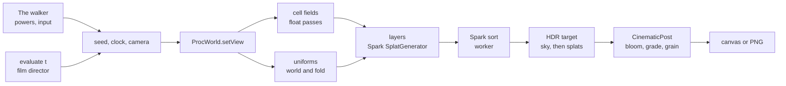

# Architecture

Reality Origami draws an endless world as Gaussian splats that a GPU program invents every frame. Three entry points share one engine: the playable page, the film renderer and a test bench. This page explains how the parts fit together and why they have this shape.



| Entry point | File | What it does |
| --- | --- | --- |
| The page | `index.html`, `src/main.ts` | The world. The only input of `npm run build` |
| The film renderer | `film.html`, `src/film/film.ts` | Draws one film frame on request through `window.film`. `scripts/capture/render-frames.mjs` drives it |
| The test bench | `lab.html`, `src/lab/` | Draws stills at chosen camera poses, times live runs, renders the score offline and samples the GPU terrain |

`film.html` and `lab.html` work on the Vite dev server and are not part of the build.

## Nothing is stored

The world is a function of a seed, a clock and a camera. No model, texture, image, font or sound file exists in the source tree, and the page loads none. `tests/assets.test.ts` enforces this. It fails when the tree holds such a file, when the page calls `fetch` or loads a media element, a font or an address, or when the page depends at run time on anything besides `three` and `@sparkjsdev/spark`.

Two things follow. The world has no stored extent, because the shaders hash integer cell coordinates. And no upload happens per frame, because the CPU never builds a splat.

## The fold keeps each splat's shape

A splat is a small ellipsoid with a covariance `Σ`. When the ground rolls into a planet, the centre of each splat moves, and its shape must follow. A fold is a smooth map `f`, and the covariance moves by `Σ' = J Σ Jᵀ`, where `J` is the Jacobian of `f` at the centre. Normals move by `cofactor(J)`. Everything in `src/core/deform` exists to make that exact and checkable.

`src/core/deform/stages.ts` is the reference. Each stage returns a position and a Jacobian, and the chain multiplies the Jacobians. It runs in double precision. `deformPoint` applies the stages in this order.

| Stage | Set by | Used by the world |
| --- | --- | --- |
| `frame` | `foldSpec` in `src/world/folds.ts` | Yes. The other stages run in a frame that follows the walker, so a fold happens around whoever calls it |
| `grab` | nothing | No |
| `twist` | `corkscrew` power | Yes |
| `curves` (up to two) | `hinge` power | Yes, one curve |
| `bowl` | `planet` power | Yes. Rolls the ground into a sphere of 150 m radius and fades out what rolls past the far side |
| `wave` | `ripple` | Yes |
| `similarity` | nothing | No |

`grab` and `similarity` come from the first version of the project, which let you drag a street. The world never sets them. They stay in the shader and the tests.

`src/world/glsl/deform.glsl` is the same maths in GLSL, and `src/world/uniforms.ts` packs a `DeformSpec` into uniforms. No test compares the shader with the reference. `tests/deform.test.ts` checks the reference against finite differences for the curve stage, the bowl and the wave alone and for every stage composed, including points above and below the ground plane. The lab stills and the film are the only evidence that the shader agrees with it.

## Layers

A layer is a `ProcLayer` in `src/world/layer.ts`. It is a Spark `SplatGenerator` that owns a fixed range of splat indices. For each index, one fused GPU program runs `runLayer` from `src/world/glsl/entry.glsl`.

1. The layer's `layerGen(index, field, surfel)` makes a surfel (position, normal, size, colour, opacity) from the index, the seed and the clock. It returns false when the index has nothing to draw.
2. The fold moves the surfel, and the covariance and the normal follow.
3. The shader lights the surfel with the folded normal: sun, hemisphere ambient, translucency, rim, the travelling light rings and the flash.
4. Height fog and haze mix in.
5. The shader packs the result as a Gaussian. An index that returns false is packed inactive, and Spark drops it.

`ProcWorld.setView` in `src/world/procworld.ts` writes the uniforms, asks the cell fields to fill and calls `updateVersion` on every layer, so Spark regenerates all of them each frame.

| Layer | Source | Splat slots | Draws |
| --- | --- | ---: | --- |
| `groundNear0`, `groundNear1` | `layers/ground.ts` | 190,112 | Two fine rings around the walker. They cut facets of 0.9 m into more splats, where the eye is closest to the ground and a splat of the first full ring would show as a soft blot |
| `ground0` to `ground6` | `layers/ground.ts` | 1,105,920 | Seven clipmap rings of flat paper facets, from 0.9 to 656 m. Facets triple in size from ring to ring, so they keep a similar size on screen |
| `flora0` to `flora3` | `layers/flora.ts` | 970,400 | Four size classes of objects, one per cell, with cells of 5, 20, 70 and 260 m. The realm at the cell picks the species |
| `wonders` | `layers/wonders.ts` | 179,712 | Arches, gates, rib cages, spires, stone circles, floating isles and paper cranes and boats, one per 900 m cell at most, in an 8 by 8 window |
| `motes` | `layers/motes.ts` | 200,000 | Sand, lanterns, fireflies, snow and embers in a box around the player |
| `flocks` | `layers/fliers.ts` | 43,920 | 18 flocks of up to 40 cranes or fish |
| `blooms` | `layers/blooms.ts` | 12,288 | Flowers that open at the last 128 footfalls and last 30 s |
| `clouds` | `layers/clouds.ts` | 4,096 | One soft sheet of paper per splat, drifting 200 to 400 m over the player. Coverage follows the realm's cloud amount, and the Deep has none |
| `beasts` | `layers/beasts.ts` | 7,696 | Six whales, and ten mantas and jellyfish in the Deep |
| Total | | 2,714,144 | The count the stats overlay shows |
| `mirror-flora2`, `mirror-flora3`, `mirror-wonders` | `layers/mirror.ts` | 579,904 | Upside-down copies of the tall layers, for the water of the Mirror Flats. They run only where water is in view, so every other realm pays nothing for them. A mirror is the program of its source with `p4.y` set to 1, so it adds no shader to build |

The sum of the slots matches the count that the page reports with `?stats`, which leaves out the mirror layers while they are off.

### Slots are not drawn splats

A layer owns slots, and it declines the ones that are out of range, in an empty cell or folded away. Spark drops a declined slot, so the number of splats a frame draws is smaller than the slot count. Spark reports it as `SparkRenderer.activeSplats`, the instance count of the draw call.

`scripts/qa/splat-census.mjs` reads that number at the spawn of each realm for seed 1 at 1280 by 720. The page draws a median of 983,053 splats from 2,714,144 slots, which is 36 %. The five realms range from 935,843 to 1,126,302. The ground draws most of them. The view cull (below) keeps the splats outside the view in the draw order, so this count does not fall when the cull works.

| Layer family | Slots | Drawn (median of five realms) | Share of its slots |
| --- | ---: | ---: | ---: |
| `ground` (nine rings) | 1,296,032 | 868,086 | 67 % |
| `flora` | 970,400 | 77,037 | 8 % |
| `motes` | 200,000 | 19,379 | 10 % |
| `wonders` | 179,712 | 14,456 | 8 % |
| `flocks` | 43,920 | 6,842 | 16 % |
| `beasts` | 7,696 | 1,341 | 17 % |
| `blooms` | 12,288 | 0 | 0 % |
| `clouds` | 4,096 | counted in the total only | - |

The motes are the exception to the pattern. In Lantern Deep they draw 164,026 of their 200,000 slots, because `motes.glsl` keeps 85 % of the motes there and 3 to 10 % in the other realms. The blooms draw nothing at four of the five spawns, where no footstep has happened yet, and 4,944 splats in the Flats, where one must have happened before the count (inferred). Each row is one camera pose per realm, so a flight at height or a crowd of footfalls draws a different count.

Declined slots cost little in the current build. A measurement taken while the engine was built, and not stored in this repository, showed that 4 million idle slots cut a 60 fps scene to 46 fps with 200 ms hitches. `scripts/qa/saturated.mjs idle` measures it again. A layer of 1, 2 and 4 million slots that all decline adds 0.20, 0.35 and 0.55 ms to a 10.2 ms frame at 1280 by 720 (measured, `docs/benchmarks/saturated-idle.txt`). A layer of 4 million slots that joined a paced page cost one 33 ms frame and no other slow frame in the next 2.5 s (measured by hand, not stored). The first reading does not hold for this version of Spark, and nothing here says why it differed. The engine keeps size-class layers instead of one layer per species, which keeps the number of layers and shader programs small. A layer reserves slots for its largest object, and the realm at each cell picks which species fills them.

### The view cull

The generators shade every slot, and a large share of the slots lie outside the picture. `ProcWorld.setView` builds four planes through the eye from the camera's quaternion, field of view and aspect ratio (`src/world/cull.ts`). It widens each half angle by 0.5° and hands the planes to the shaders in `WorldParams`.

`runLayer` tests each splat's centre against the planes after the fold. The radius it allows is 2.83 standard deviations of the splat's covariance, plus one metre, plus 1 % of the splat's distance, so a splat on the edge of the picture is kept. A splat that fails skips the lighting, the fog and the packing and returns `culledSplat`. The ground tests earlier, right after it builds the triangle of a facet and before it looks up the realm and the surface. It may do so only when no fold moves the world (`isIdentitySpec`), because only then does a splat's rest position equal the one it is drawn at.

A culled splat stays in the draw order with no opacity. Spark's sort lags the camera by a frame or two, so an ordering built for the last pose lists the splats that were active then. A splat that dropped out of the list would leave a hole when the camera turned toward it, until the next sort finished. A splat that stays listed with no opacity costs one fetch in Spark's vertex stage, which drops it. That is why `activeSplats` does not fall with the cull.

The cull turns off under depth of field (`apertureAngle > 0`), for a view whose half angle passes 80° and when `world.cullEnabled` is false. `tests/cull.test.ts` holds the contract, and the 19 poses of `scripts/qa/game-shots.mjs` come out byte-identical to the frames from before it. `docs/BENCHMARKS.md` has what it saves.

### Levels of ground detail

`GroundRings.setDetail` picks one of four levels. Each lowers the subdivision of every ring, so a facet's triangle holds fewer and larger splats (`ringSubdivision`). The layers keep their slots and the shader declines the ones past the last cell. The page picks the level from the render scale it applies (`groundDetailFor` in `src/play/quality.ts`), so a machine that falls behind loses resolution and splats together. Level 0 is the full world and level 1 looks the same to the eye in Ember, Prism and Flats. Level 3 smears thin lines on the ground, such as the lava cracks of Ember. `docs/BENCHMARKS.md` has what the levels save.

Shrinking the layers with the level was tried and left out. Keeping the level 0 slots at level 3 added 0.65 ms at 640 by 360 and 0.15 ms at 1920 by 1080, both inside the noise of the runs (measured while the engine was built, and not stored in this repository).

## Cell fields

Many splats need the same value. A ground facet vertex is shared by 15 to 25 splats, and a flora cell is shared by every splat of its object. In the first version each splat computed the terrain height and the ground shadow itself. A measurement taken while the engine was built, and not stored in this repository, held the dunes at 20 fps with 166 ms hitches. Cell fields raised the same scene to 57 to 60 fps at 1280 by 720 with 2.32 million slots.

`CellField` in `src/world/field.ts` solves this with a small fullscreen pass per layer. It fills a float texture with the height and the ground shadow of each lattice point, plus the realm mix for flora. The splat shader reads its texel. Texel `(x, y)` holds the lattice point whose coordinates are congruent to `(x, y)` modulo the size, so a window that slides over the world keeps each lattice point in the same texel.

The terrain never changes, so a field is a function of its window, the seed and the sun direction that the ground shadow marches toward. `render` fills the texture only when one of those differs from the last fill. The window corner snaps by 8 cells for the ground and 4 for flora, so a walker triggers a fill every few seconds and a standing one never does. Twelve fields exist, seven for the ground, four for flora and one for the wonders. Before this check each of them ran every frame. Skipping the fills cut a standing frame at 1920 by 1080 from 17.9 ms to 11.6 ms, measured with the page waiting on the GPU (`docs/BENCHMARKS.md`).

The skip is only safe while the pass reads nothing else. The terrain functions read the seed, through the hash, and the sun direction, in `groundShadow`. They read no time and no camera value. A pass that starts to read one more input has to add it to `inputs` in `CellField.render`. `scripts/qa/field-cache.mjs` fails when a cached texture differs from a fresh fill, and it caught each of two deliberately broken keys.

## The CPU twin

The walker, the film camera, the spawn search and the gates need the ground height and the wonder positions on the CPU. `src/world/cpu` holds a line-for-line CPU copy of the height field, the realm blend, the wonder placement and the creature paths. `scripts/qa/terrain-probe.mjs` samples the GPU terrain at random points through `src/lab/probe.ts` and compares it with the twin. `tests/world.test.ts` checks the twin alone. The same seed gives the same world, the ground is finite at random points out to 60 km, realms blend only with their neighbours in the cycle, and each wonder stands in its own cell.

## The stage in two modes

`createStage` in `src/core/render/stage.ts` builds the renderer, the Spark renderer and an HDR target. The two modes share all of the engine.

| | Live (the page) | Capture (the film) |
| --- | --- | --- |
| Spark updates | Automatic. The sort runs in a worker and lags the camera by a frame or two | On demand. `settle()` waits until the sort matches the camera |
| Resolution | Adaptive. `ResolutionGovernor` trades pixels for frame rate between 40 % and 100 % | Fixed, with 2x supersampling |
| Motion blur | None | Sub-frames averaged by `Accumulator` |
| Entry point | `src/main.ts` | `src/film/film.ts` |

After the splats, `CinematicPost` in `src/core/render/post.ts` runs a dual-filter bloom with halation, then a filmic resolve with grade, aberration, vignette, grain and dither. The sky is not made of splats. `SkyPass` draws it into the HDR target before the splats.

## The page

`Game` in `src/play/game.ts` owns the experience. It builds the world, the walker and the HUD, and each frame it turns the state into a `WorldView`.

- `Player` (`player.ts`) walks, jumps, glides and flies on the CPU twin's ground.
- `FoldPowers` (`powers.ts`) holds one critically damped spring for each toggle power (`planet`, `corkscrew`, `hinge`) and a timer for the ripple. `foldSpec` turns the amounts into a `DeformSpec`.
- `Input` (`input.ts`) folds keyboard, mouse look and touch sticks into one frame of intent. `keyName` names the walking cluster and the number row by `event.code`, so ZQSD walks on a French keyboard and a power starts while Shift is held. Every other key goes by the letter on it.
- `RingPool` (`rings.ts`) holds the six rings of light the world can show at once. A footstep, a landing, a sung ring and a gate each add one, and a new ring takes the slot with the least light left, so a footstep fades out before its slot is wanted again. `world.glsl` carries `ring[RING_SLOTS]` and `shape[RING_SLOTS]`, `light.glsl` adds up `ringGlow` over them, and `ringLevel` is the same envelope on the CPU.
- `ResolutionGovernor` (`governor.ts`) drops the scale after 0.7 s of slow frames and probes upward after 4 s of clean ones. It remembers the scale that failed for 20 s. A gap over 250 ms counts as 250 ms, so one stall, such as a hidden tab, does not cost resolution but a run of slow frames still does.
- `Score` (`audio.ts`) makes the music from oscillators and noise. Each realm has a drone, a melody and footsteps, and the wind opens with speed.
- `lightningAt` (`world/storm.ts`) is the weather of the Ember Canyons. Time is cut into 6 s slots, a slot may hold one flash of two or three strokes, and a hash of the slot and the seed decides everything about it. The sky, the light on the ground and the thunder all read the same function of the clock, so they agree and nothing has to be saved. `Game` hands the flash to the shaders as `WorldView.storm` and starts the thunder once per flash. The film passes none, so it has no lightning. `?calm` and the system setting for reduced motion turn the flashes off.
- `compileShaders` (`world/procworld.ts`) runs from `main.ts` before the first frame. Spark gives each layer a `RawShaderMaterial`, and three.js reuses a program whose source it has seen, so the 22 layers need 8 programs. The ground rings share one, the four size classes of flora share one, and a water mirror shares the program of the layer it copies (`tests/programs.test.ts`). Left alone, the first frame meets the eight one at a time, and each `getProgramInfoLog` waits for the draw before it. `compileShaders` hands all eight to `renderer.compile` first, so the links overlap. `main.ts` then waits for one paint, so the loading box can say what it is doing before the first frame holds the page.
- `findSpawn` (`spawn.ts`) picks the first view. It looks for a gentle spot of the realm with a wonder in sight and a clear line ahead.
- `share.ts` stores the seed and the walker's place in the URL hash. Parsing rejects a link with a missing place or a value out of range.

## The film

`evaluate(t)` in `src/film/director.ts` is a pure function. It maps a time to everything a frame needs: the camera, the world clock, the folds, the light rings, the grade and the titles.

- `shots.ts` defines 15 shots. Each flies the camera along a path inside one realm.
- `cues.ts` reads `audio-cues.json`, which `scripts/audio/analyze.py` and `scripts/audio/export_cues.py` derive from the track. It holds the bar grid, the impacts, the risers, the stop and the snap.
- `rig.ts` defines the camera `Pose` and the helpers that aim, blend and ease it, plus a hand-held drift.
- `blur.ts` picks how many sub-frames each frame needs from the motion in the shot. `evaluateWithin` keeps the sub-frames of a frame inside its shot, so a cut stays hard.
- `titles.ts` holds the closing card, the only text in the film.

`tests/film.test.ts` checks that every named cue lies within 0.03 s of an impact or onset of the analysed track, that the cuts fall on the beat grid or on a marked hit, and that every frame of the film has a camera above the ground, a sane lens and no jump inside a shot. It also fails when the world moves a place that a shot names.

## Adding a wonder

A wonder is a name in a TypeScript table and a shape in GLSL. The paper boat (commit `2ee3bc4`) is the smallest example. It touched four files.

1. `src/world/wonders.ts` holds the tables. Add the kind to `WONDER_KINDS`, a size range to `SIZE_RANGE` and a pool of nouns to `nouns`, and the compiler stops until all three exist. Then decide where it stands. A realm lists its three kinds in `KINDS_BY_REALM`. The crane and the boat show the other way, a rate per realm and a salt of their own, so a hash roll swaps the kind in a share of the cells and every other cell keeps its wonder. `wonderGlslTables` writes the tables into the shader, so the two sides cannot disagree about a kind's index. `wonderInCell` is the CPU twin of `layerGen` and has to draw the same rolls in the same order.
2. `src/world/glsl/wonders.glsl` draws it. Write a function that returns triangle `tri` of the wonder and its material, give it a `case` in `buildWonder` and a colour in `wonderColors`. `layerGen` gives each triangle 9, 4 or `PAPER_PATCH` squared splats, set by `stride`. Every wonder owns `SLOTS` splat slots in `src/world/layers/wonders.ts`, so its triangles times its stride must fit in them.
3. `tests/world.test.ts` pins the realms the wonder appears in, its share of the cells and its names. `wonderAt` in `src/film/shots.ts` throws when a shot names a wonder that no longer stands where it did, and it runs when `tests/film.test.ts` loads the shots. A new kind that takes over a cell the film flies to fails that file. Render the film again after any change a shot can see.
4. `scripts/qa/shader-cost.mjs` says what the kind cost a first visit. Every kind lands in the one wonders program, which is the slowest of the eight to build. It took 0.93 s alone in Chrome and 5.5 s in Firefox on the tested Mac (measured), and a visitor waits for it.

## Where things are

```
src/core/deform     the fold, written once in double precision
src/core/render     stage, HDR target, bloom and grade
src/world           layers, GLSL, cell fields, realms, wonders
src/world/cpu       the CPU twin of the height field, wonders and creatures
src/play            the experience: walker, powers, input, HUD, score, quality
src/film            the director, shots, cue sheet, motion blur, titles
src/lab             the test bench
scripts/qa          checks and measurements, see docs/QA.md
scripts/capture     film rendering and encoding
scripts/audio       beat and impact analysis of a track
```
